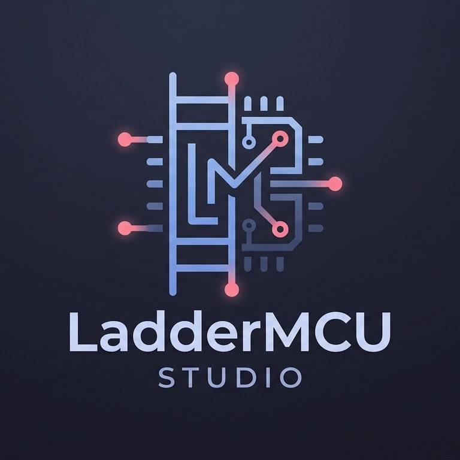

<div align="center">
  

  <h1>LaduinoPLC — IEC 61131-3 Ladder Diagram IDE & RP2040 Micro-VM</h1>

  <p>
    <strong>ซอฟต์แวร์ออกแบบและจำลองวงจร PLC มาตรฐาน IEC 61131-3 พร้อมรันไทม์ 32-bit Micro-VM สำหรับบอร์ด Raspberry Pi Pico (RP2040)</strong><br />
    <em>Fast, modern IEC 61131-3 Ladder Logic & Instruction List (<code>.il</code>) IDE, Real-Time Simulator, and Embedded Microcontroller Runtime written in Rust.</em>
  </p>

  <p>
    <a href="https://pksofttech.github.io/uPLC_STUDIO/">
      
    </a>
    <a href="https://github.com/pksofttech/uPLC_STUDIO/releases/latest">
      
    </a>
  </p>
</div>

---

## 📦 ดาวน์โหลดเวอร์ชันพร้อมใช้งาน (Pre-Built Downloads — `v0.1.1`)

🌐 **หน้าเว็บไซต์หลัก & ทดลองจำลองวงจรออนไลน์**: **[https://pksofttech.github.io/uPLC_STUDIO](https://pksofttech.github.io/uPLC_STUDIO)**

| แพลตฟอร์ม (Platform) | ลิงก์ดาวน์โหลดตรง (Direct Download) | รายละเอียด (Contents) |
| :--- | :--- | :--- |
| 🪟 **Windows 10 / 11 (64-bit)** | [**⬇ ดาวน์โหลด `.zip` สำหรับ Windows**](https://github.com/pksofttech/uPLC_STUDIO/releases/latest/download/laduino-plc-v0.1.1-x86_64-pc-windows-msvc.zip) | `laduino-plc.exe` + เฟิร์มแวร์ `.uf2` + 14 ตัวอย่างวงจร `.il` |
| 🐧 **Linux (x86_64)** | [**⬇ ดาวน์โหลด `.tar.gz` สำหรับ Linux**](https://github.com/pksofttech/uPLC_STUDIO/releases/latest/download/laduino-plc-v0.1.1-x86_64-unknown-linux-gnu.tar.gz) | ไบนารี `laduino-plc` + เฟิร์มแวร์ `.uf2` + 14 ตัวอย่างวงจร `.il` |
| 🍓 **RP2040 Micro-VM (`.uf2`)** | [**⚡ ดาวน์โหลดเฟิร์มแวร์ `.uf2`**](https://github.com/pksofttech/uPLC_STUDIO/releases/latest/download/uplc-rp2040-embassy.uf2) | เฟิร์มแวร์สำหรับลากวางลงไดรฟ์ `RPI-RP2` (USB BOOTSEL) |

---

## ✨ ฟีเจอร์หลัก (Key Capabilities)

- **IEC 61131-3 Ladder & IL Editor**:
  - วาดวงจรด้วยเมาส์และคีย์ลัดความเร็วสูง รองรับ Contact (`NO`, `NC`, `P-Edge`, `N-Edge`), Coil (`Normal`, `Negated`, `Set`, `Reset`), Parallel Branch, Multi-line Network Comment
  - แปลงโค้ดไป-กลับระหว่างผังวงจร **Ladder Diagram** และ **Instruction List (`.il`)** มาตรฐาน IEC 61131-3 แบบไร้การสูญเสีย
- **Industrial Function Blocks**:
  - **Timers & Counters**: `TON`, `TOF`, `TP`, `CTU`, `CTD`, `CTUD`
  - **Math, Logic & Data**: `ADD`, `SUB`, `MUL`, `DIV`, `MOD`, `MOV`, `SHL`, `SHR`, `AND`, `OR`, `XOR`
  - **Process Control**: `PID` Controller, Linear `SCALE`, `LIMIT`, `DRUM` Sequencer, 12-bit `ADC` (`%IW0..%IW3`)
  - **Industrial Communication**: `MB_MASTER` (**Modbus RTU Master** ผ่าน RS-485 Functions `03`, `04`, `06`) และ `UART`
- **Real-Time Simulator & Hardware Online Monitor**:
  - จำลองการทำงานแบบออฟไลน์ได้ทันทีบนคอมพิวเตอร์ (`F5 = Run/Stop`, `F6 = Single Step`)
  - เชื่อมต่อบอร์ด **Raspberry Pi Pico (RP2040)** ผ่านพอร์ต USB-CDC เพื่อดูสถานะกระแสไหลจริง (`F7 = Online Monitor`), สั่ง **Force I/O** และตรวจสอบโค้ดตรงกันด้วย **CRC16**
  - รองรับหน่วยความจำจำค่าเมื่อไฟดับ (**RETAIN Flash**: `M64..M95`, `D96..D127` / `%MW96..%MW127`)
- **1-Click USB BOOTSEL Flasher**:
  - มีหน้าต่างแฟลชเฟิร์มแวร์ `.uf2` ลงบอร์ด RP2040 ในตัวโดยไม่ต้องติดตั้งเครื่องมือคอมไพล์เสริม

---

## 🛠️ การคอมไพล์จากซอร์สโค้ด (Build from Source)

```bash
# รันโปรแกรมบนเครื่อง (Desktop IDE)
cargo run --release -p laduino-plc

# รันชุดทดสอบทั้งหมด (Unit + Differential VM Tests)
cargo test --workspace

# สร้างแพ็กเกจ Release ทั้งหมด (Windows + Linux + RP2040 .uf2) ลงโฟลเดอร์ releases/
bash .agents/skills/uplc-product-release/scripts/package_release.sh
```

---

## 💖 ร่วมสนับสนุนการพัฒนา (Support & Donate)

หากโปรแกรม **LaduinoPLC** เป็นประโยชน์ต่อการเรียนการสอนหรือการทำงานของคุณ สามารถร่วมสนับสนุนทีมพัฒนา (**pksofttech.org**) ได้ที่:
- ☕ **Buy Me a Coffee**: [https://buymeacoffee.com/pksofttech](https://buymeacoffee.com/pksofttech)
- 💜 **GitHub Sponsors**: [https://github.com/sponsors/pksofttech](https://github.com/sponsors/pksofttech)
- 🇹🇭 **PromptPay (พร้อมเพย์)**: ดู QR Code ได้ที่หน้าเว็บไซต์ [https://pksofttech.github.io/uPLC_STUDIO/#donate](https://pksofttech.github.io/uPLC_STUDIO/#donate)
